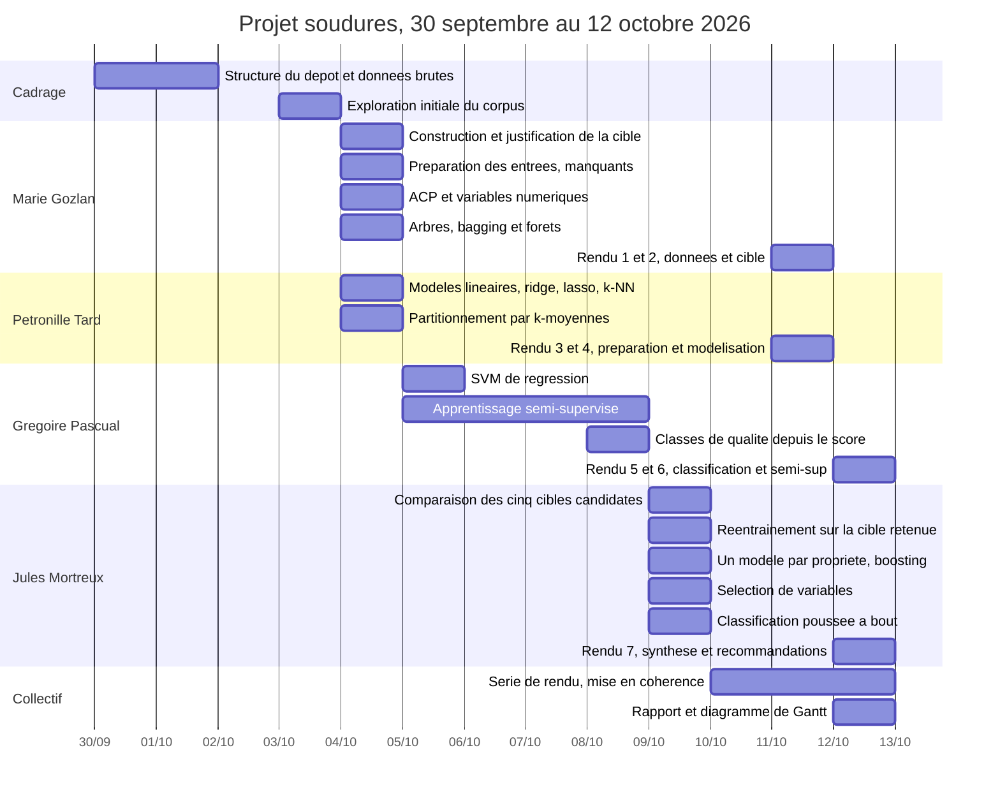

# Diagramme de Gantt

Projet 3IF3010, prédiction de la qualité de soudures. Équipe n° [A COMPLETER].

Les dates sont celles de l'historique Git du dépôt, donc vérifiables. Les
charges sont des estimations déclarées par chaque membre.

## Répartition détaillée

| Tâche | Responsable | Début | Fin | Charge | Livrable |
|---|---|---|---|---|---|
| Structure du dépôt, données brutes | Jules | 30/09 | 01/10 | [A COMPLETER] | `data/raw/`, `README.md` |
| Exploration initiale du corpus | Jules | 03/10 | 03/10 | [A COMPLETER] | `notebooks/01` |
| Construction et justification de la cible | Marie | 04/10 | 04/10 | [A COMPLETER] | `notebooks/02` |
| Préparation des entrées, manquants, encodage | Marie | 04/10 | 04/10 | [A COMPLETER] | `notebooks/03` |
| ACP et exploration des variables numériques | Marie | 04/10 | 04/10 | [A COMPLETER] | `notebooks/04` |
| Arbres, bagging et forêts | Marie | 04/10 | 04/10 | [A COMPLETER] | `notebooks/05` |
| Modèles linéaires, ridge, lasso, k-NN | Pétronille | 04/10 | 04/10 | [A COMPLETER] | `notebooks/06` |
| Partitionnement par k-moyennes | Pétronille | 04/10 | 04/10 | [A COMPLETER] | `notebooks/07` |
| SVM de régression | Grégoire | 05/10 | 05/10 | [A COMPLETER] | `notebooks/08` |
| Apprentissage semi-supervisé, bibliographie | Grégoire | 05/10 | 08/10 | [A COMPLETER] | `notebooks/09`, `src/preparation.py` |
| Classes de qualité à partir du score | Grégoire | 08/10 | 08/10 | [A COMPLETER] | `notebooks/10` |
| Comparaison des cinq cibles candidates | Jules | 09/10 | 09/10 | [A COMPLETER] | `notebooks/11` |
| Réentraînement sur la cible retenue | Jules | 09/10 | 09/10 | [A COMPLETER] | `notebooks/12` |
| Un modèle par propriété, ajout du boosting | Jules | 09/10 | 09/10 | [A COMPLETER] | `notebooks/13` |
| Sélection de variables | Jules | 09/10 | 09/10 | [A COMPLETER] | `notebooks/14` |
| Classification poussée à bout | Jules | 09/10 | 09/10 | [A COMPLETER] | `notebooks/15` |
| Série de rendu, mise en cohérence | les 4 | 10/10 | 12/10 | [A COMPLETER] | `notebooks/rendu/1` à `7` |
| Rapport et diagramme de Gantt | [A COMPLETER] | 12/10 | 12/10 | [A COMPLETER] | `rapport/` |

## Qui a poussé quoi

Chaque membre a poussé le notebook de rendu qui consolide son propre travail
d'exploration, de sorte que l'historique Git reflète la contribution réelle.

| Membre | Notebooks d'exploration | Notebooks de rendu | Pull request |
|---|---|---|---|
| Marie Gozlan | 02, 03, 04, 05 | 1, 2 | #2 |
| Pétronille Tard | 06, 07 | 3, 4 | #1 |
| Grégoire Pascual | 08, 09, 10 | 5, 6 | #5 |
| Jules Mortreux | 01, 11, 12, 13, 14, 15 | 7 | #3, #4 |

## Deux phases, et pourquoi

**Phase d'exploration, 30 septembre au 9 octobre.** Répartie par méthode, un
membre par famille de modèles. Elle a produit les quinze notebooks
`notebooks/01` à `15`, dans l'ordre chronologique où le travail a été mené.

**Phase de consolidation, 10 au 12 octobre.** Elle a produit la série
`notebooks/rendu/`, sept notebooks dans l'ordre logique, ne retenant que les
meilleurs choix en expliquant chaque fois pourquoi, et renvoyant à
l'exploration pour le détail des pistes écartées.

Cette seconde phase n'était pas prévue au départ. Elle a été décidée après le
constat qu'une exploration répartie par méthode produit un parcours décousu
pour un lecteur : le choix de la cible, par exemple, avait été fait au notebook
02 puis remis en cause au notebook 11, ce qui obligeait à relire l'ensemble
dans un ordre que rien n'indiquait. Le coût de cette phase a été de trois jours
pour quatre personnes, et nous la considérons comme le meilleur investissement
du projet.
